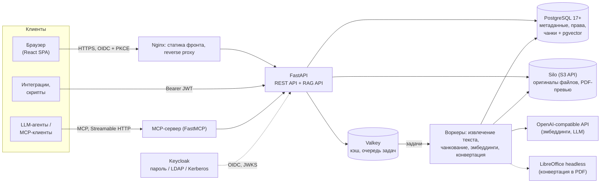
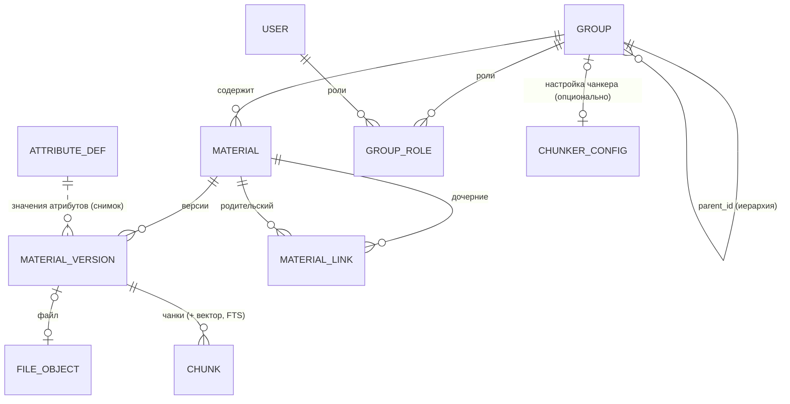
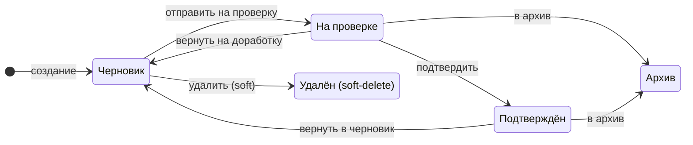

# Корпоративная база знаний — концепция системы

- **Статус:** черновик для обсуждения (v0.3, 2026-11-20 — учтены решения двух раундов обсуждения)
- **Цель документа:** зафиксировать понимание требований, предложить архитектуру и проектные решения, собрать открытые вопросы. Это не ТЗ на реализацию — структура и детали могут меняться по итогам обсуждения.
- **Как читать:** каждый раздел опирается на нумерованные требования (1–38). Соответствие «требование → раздел» — в §17. Итоги обсуждения (решённые и оставшиеся вопросы) — в §16.

---

## 1. Проблема и цель

Знания компании разбросаны по сотрудникам и личным «блокнотикам»: найти нужную информацию трудно или невозможно. Нужна система, которая становится **единым источником истины** по корпоративным знаниям: централизованное хранение, учёт (кто, что, когда, в каком статусе), поиск (полнотекстовый, по атрибутам, семантический) и использование знаний машинами (RAG по API и через MCP).

Целевые пользователи: все сотрудники (чтение), редакторы знаний и владельцы разделов (наполнение и контроль качества), интеграции и LLM-агенты (через API/MCP).

## 2. Термины

| Термин | Значение |
|---|---|
| **Материал** (Material) | Минимальная единица информации в системе (треб. 3). Обязательно содержит файл с данными (треб. 6), может иметь ссылку на внешний источник (треб. 7) |
| **Группа** (Group) | Контейнер для материалов и других групп; поддерживает иерархию (треб. 4, 5). На неё выдаются права (треб. 15) и настраивается чанкование (треб. 22) |
| **Версия** | Снимок содержимого материала (файл + данные); любое изменение содержимого или замена файла = новая версия (треб. 25) |
| **Чанк** (Chunk) | Фрагмент текста документа, по которому строится поиск и RAG-контекст |
| **Чанкер** | Способ разбиения текста на чанки (встроенный или самописный Python-плагин) |
| **Роль** | Права пользователя в конкретной группе: Читатель / Редактор / Проверяющий / Владелец (треб. 30; роль «Проверяющий» добавлена решением по итогам обсуждения) |
| **Проверяющий / Подтвердивший** | Пользователь, который в данный момент проверяет или подтвердил корректность материала (треб. 11, 24) |

## 3. Общая архитектура



Ключевые решения:

- **Тонкий слой авторизации везде один и тот же.** Веб, REST API, RAG API и MCP работают с одними и теми же правами из БД — треб. 15–18, 36 выполняются «автоматически».
- **Асинхронная обработка файлов.** Загрузка файла кладёт задачу в очередь (Valkey); воркеры извлекают текст, чанкуют, векторизуют и генерируют превью. API не блокируется на тяжёлых операциях. Обоснование выбора очереди (Valkey vs RabbitMQ vs Kafka) — §13.1.
- **Векторный слой — за абстракцией `VectorStore`** (upsert / delete / search / filter). Старт — pgvector, миграция на Qdrant — по триггерам (§14) без переписывания бизнес-логики.

## 4. Аутентификация: Keycloak (треб. 1, 2)

**Realm** `corp-kb`. Все способы входа ведут к **одному и тому же пользователю Keycloak**, сопоставленному с учётной записью в корпоративном LDAP/AD — этим обеспечивается «разные способы входа для одного пользователя» (треб. 1):

| Способ входа | Механизм |
|---|---|
| Логин + пароль | User Federation → LDAP/AD: пароль проверяется в каталоге (bind), пользователь автоматически импортируется в realm |
| Сквозной вход с доменной машины (как SharePoint) | Kerberos / SPNEGO: Keycloak с keytab и SPN `HTTP/kb.<домен>`, в browser flow Kerberos = *alternative*; principal сопоставляется с LDAP-пользователем по атрибуту `userPrincipalName` (это штатная связка «LDAP federation + Kerberos» в Keycloak 26.x) |
| Прочие способы в будущем | Identity brokering (любой внешний OIDC/SAML IdP) с привязкой к тому же пользователю (account linking) |

Ограничения и требования к инфраструктуре Kerberos (важно заложить заранее):

- SPN `HTTP/kb.<домен>` зарегистрирован в AD, keytab выгружен для Keycloak, синхронизация времени.
- На клиентских машинах доменные браузеры должны доверять сайту для SPNEGO (Intranet Zone в IE/Edge, `AuthServerAllowlist`/`AuthNegotiateDelegateAllowlist` в Chrome) — настраивается через групповые политики. Без настройки браузера будет обычный экран логина (fallback штатный).
- Kerberos/SPNEGO работает только внутри доменной сети на доменных машинах; извне — пароль (или MFA, если решим добавить).

Клиенты:

- **Веб (React):** Authorization Code + PKCE, silent renew, logout.
- **REST API / RAG API / MCP:** Bearer JWT (RS256). FastAPI-мидлварь проверяет `iss`, `aud`, подпись по JWKS (кэш ключей), извлекает `sub` → пользователь системы.
- **Интеграции и агенты:** технические учётные записи (service accounts) в Keycloak; им роли в группах выдаются как обычным пользователям — права работают одинаково (треб. 18).

**Права и роли — НЕ в Keycloak.** Роли в группах (§8) хранятся в БД системы и выдаются владельцами групп через UI: владельцы разделов не должны быть администраторами Keycloak. Keycloak отвечает только за «кто вы», система — за «что вам можно».

## 5. Предметная модель (треб. 3–8, 12, 13)



### 5.1 Группа

- Поля: `id`, `parent_id` (null — корневая), `name`, `description`, `is_deleted`, аудиторские поля.
- Иерархия — дерево произвольной глубины (треб. 5); циклы запрещены проверкой при создании.
- **Уникальность имени** — среди не удалённых групп в рамках одной родительской группы (треб. 13): частичный уникальный индекс `unique (parent_id, lower(trim(name))) where not is_deleted`. Для корневых групп `parent_id is null` учитывается в индексе.
- **Soft-delete только** (треб. 12): `is_deleted=true` скрывает группу из навигации и поиска; данные не удаляются. **Удалять группу запрещено, пока в её иерархии (включая вложенные группы) есть действующие (не удалённые) материалы** (решено); действующие подгруппы перед удалением родителя удаляются первыми — удаление «снизу вверх».
- Настройка чанкера — на уровне группы, опциональна (§9).

### 5.2 Материал

- Поля: `id`, `group_id`, `name`, `description`, `external_url` (опционально, треб. 7), `status` (§6), `author_id` (обязателен, треб. 24), `current_version_id`, `is_deleted`, аудиторские поля.
- **Уникальность имени** — среди не удалённых материалов в рамках своей группы (треб. 13).
- Файл — обязателен (треб. 6): у материала всегда есть хотя бы одна версия с файлом.
- **Ссылки на внешние источники** (треб. 7): список URI произвольной схемы (http/https, сетевой путь, ссылка на внешнюю DMS), каждый — с меткой («опубликовано на сайте», «первоисточник»; решено — ссылок может быть несколько). Типовой сценарий — новостная статья: в КБ кладём копию (файл) и ссылку на страницу сайта.

### 5.3 Версия материала

- Поля: `id`, `material_id`, `version_no` (монотонный, с 1), `file_id`, `attributes` (снимок значений атрибутов, jsonb), `change_comment`, `created_by`, `created_at`, `file_sha256`.
- Новая версия создаётся при **любом** изменении содержимого или замене файла (треб. 25). Если файл не менялся (тот же sha256) — версия ссылается на прежний объект файла, дублирования в хранилище нет.
- **В индекс поиска и RAG попадает только актуальная версия** (решено); история версий доступна для просмотра и скачивания.
- Кем проверена/подтверждена — хранится в снимке версии (`reviewer`, `confirmed_by`, `confirmed_at`), поэтому «история согласований» восстанавливается по версиям (треб. 24).

### 5.4 Файл и атрибуты

- `FILE_OBJECT`: `storage_key` (Silo), `original_filename`, `mime`, `size`, `sha256`, `preview_key` (сгенерированный PDF, §12), `text_extracted` (признак успешного извлечения текста).
- Поддерживаемые в MVP форматы: PDF, DOCX, XLSX, PPTX, TXT, MD, HTML, изображения. DOC/ODT/RTF — через конвертацию в PDF + извлечение текста из PDF.
- **Атрибуты** (для поиска по значениям, треб. 14): системный справочник `ATTRIBUTE_DEF` (ключ, название, тип: строка / число / дата / флаг / селект / мультиселект). Значения — в снимке версии (jsonb), фильтрация через GIN-индекс. Решено: справочник общий на всю систему, схемы атрибутов на уровне групп не вводим.

### 5.5 Связи «родительский материал» (треб. 26–28)

- `MATERIAL_LINK`: `child_id`, `parent_id`, `parent_version_id`, `created_by`, `created_at`.
- При создании связи фиксируется **конкретная версия родителя — актуальная на момент привязки** (треб. 27).
- Обновление родителя **ничего не меняет** в потомках (никаких каскадов, треб. 28). UI показывает индикатор: «привязана версия N, актуальная M» (N < M), с переходом к родителю.
- У материала **не более одного родителя**; детей может быть много (перевод, версия для соцсетей и т.п.) — решено.

## 6. Жизненный цикл материала: статусы (треб. 9–12)



Разрешённые переходы (всё остальное — запрещено):

| Откуда → Куда | Кто может | Смысл |
|---|---|---|
| Черновик → На проверке | Редактор / Владелец | Автор/редактор завершил работу, просит проверки |
| На проверке → Подтверждён | **Проверяющий** / Владелец / Админ | Корректность подтверждена; фиксируется `confirmed_by/at` |
| На проверке → Черновик | Проверяющий / Владелец | Замечания, доработка |
| Подтверждён → Черновик | Владелец / Проверяющий / Админ | Материал устарел / требует переработки |
| На проверке → Архив | Редактор / Владелец | Исключение из ТЗ: архивация без подтверждения |
| Подтверждён → Архив | Редактор / Владелец | Документ устарел, но должен оставаться доступным |
| Черновик → Удалён | Автор / Редактор / Владелец | Soft-delete (треб. 10, 12): «не проходил проверку и нигде не участвует» |

Семантика статусов — по треб. 11. Дополнения (решения по итогам обсуждения):

- **Архив и Удалён — конечные состояния** (обратных переходов нет; восстановление невозможно, при необходимости материал создаётся заново **копированием** — новый черновик с переносом метаданных и файла).
- Материал в статусе «Удалён» одновременно помечается `is_deleted=true` (soft-delete, треб. 12) и исчезает из навигации/поиска; материалов в других статусах это не касается.
- **Редактирование подтверждённого материала** (решено): создаётся новая версия, статус сбрасывается в «Черновик» — подтверждённым может считаться только проверенный снимок.
- **Видимость по статусам** (решено): Читатель видит все статусы, кроме «Удалён»; Редактор и выше — то же. Статус «Удалён» в навигации и поиске не участвует ни для кого (события фиксирует аудит).

### 6.1 Уведомления

- Канал MVP — **email**; доставка — через очередь задач с абстракцией «канал», чтобы позже добавить вебхуки/мессенджеры без переделки (решение по итогам обсуждения).
- **Настройка событий на уровне ролей** (системная настройка): какие события и каким типам ролей доставляются. Пример из обсуждения: Проверяющий получает уведомление о создании нового материала в любой группе, где у него есть роль Проверяющего.
- Базовый набор событий: материал создан; отправлен на проверку; подтверждён; возвращён на доработку; отправлен в архив; выданы/изменены права; родительский материал обновился.

## 7. Версионирование и родительские связи (треб. 25–28)

См. §5.3 и §5.5. Кратко:

- Изменение данных или замена файла → новая версия с инкрементом `version_no`; комментарий изменения обязателен.
- Список версий с diff-метаданными (что изменилось: файл/атрибуты) — в UI материала.
- Индикатор «родитель обновился» — сравнение `link.parent_version_id` с `parent.current_version_id` (§5.5).

## 8. Права доступа (треб. 15–16, 29–36)

### 8.1 Роли

| Роль | Права в своей группе |
|---|---|
| **Читатель** | Только чтение (треб. 31): просмотр групп, материалов, скачивание/превью, поиск |
| **Редактор** | Чтение + создание и редактирование материалов, смена статусов (кроме подтверждения), soft-delete (треб. 32) |
| **Проверяющий** | Всё, что Редактор, + **подтверждение** материалов (На проверке → Подтверждён) и возврат на доработку. Роль добавлена решением по итогам обсуждения (треб. 30 перечислял три роли) |
| **Владелец** | Всё, включая подтверждение и выдачу ролей другим пользователям в своей группе (треб. 33) |
| **Администратор системы** | Полный доступ везде, минуя проверки прав (треб. 35); единственный, кто настраивает чанкеры групп (треб. 34) |

### 8.2 Наследование и навигация

- Права выдаются **на группу** и действуют на все иерархически вложенные в неё группы и материалы (треб. 15).
- Право на не-верхнеуровневую группу даёт **навигационный доступ к предкам**: пользователь видит цепочку вышестоящих групп, чтобы добраться до своей, но не видит их содержимое (материалы, соседние ветки) (треб. 16).
- **Запрет по умолчанию**: нет явной роли — нет доступа (треб. 36). Аноним не видит ничего.
- При пересечении ролей в иерархии действует **объединение прав** (наиболее разрешающее): Редактор на родителе + Читатель на дочерней = Редактор внутри дочерней (решено).

Алгоритм проверки:

```
effective_role(user, G) = max по объединению ролей user на G и всех предков G
can_read(G)      = admin или есть любая роль (reader/editor/reviewer/owner)
can_edit(G)      = admin или есть роль editor/reviewer/owner
can_confirm(G)   = admin или есть роль reviewer/owner
can_grant(G)     = admin или есть роль owner
nav_only(G)      = не can_read(G), но G — предок группы с явной выдачей
видимые материалы = материалы групп, где can_read; видимость статусов — §6
```

Эффективный набор прав пользователя кэшируется в Valkey с инвалидацией при изменении ролей.

### 8.3 Где проверяются права

Единый сервис авторизации в backend вызывается из: UI-эндпоинтов REST API, поиска (фильтр результатов), RAG API и MCP — треб. 17–18. Проверка прав выполняется **на момент запроса** (не «вшивается» в индекс) — смена ролей действует мгновенно.

## 9. Чанкование и векторизация (треб. 19–23, 34)

### 9.1 Пайплайн обработки файла

```
загрузка новой версии
  → файл в Silo (S3)
  → задача в очередь (Valkey)
  → антивирус-скан (MVP: заглушка — имитация проверки фоновой задачей; до её завершения файл недоступен для скачивания и просмотра)
  → извлечение текста (PDF/DOCX/XLSX/PPTX/TXT/MD/HTML; OCR — позже)
  → чанкование способом, разрешённым по иерархии групп (§9.3)
  → эмбеддинги чанков (OpenAI-compatible API, §13)
  → запись чанков + векторов + FTS-индекса
  → (параллельно) генерация PDF-превью (§12)
```

Автоматически запускается при создании/обновлении файла (треб. 19). Чанки жёстко привязаны к `version_id` — новая версия вытесняет чанки предыдущей.

### 9.2 Виды чанкеров

- **Встроенные (стандартные):** по символам (фикс. размер + overlap), рекурсивный (по разделителям), parent-child (двухуровневый: мелкие «дочерние» для поиска, крупные «родительские» отдаются в контекст LLM), по предложениям/абзацам, токен-базированный, разметко-ориентированный (Markdown/HTML), таблично-ориентированный (лист Excel/CSV → группы строк с повторением строки заголовков в каждом чанке; в метаданные чанка — имя листа и диапазон строк). Набор стандартных расширяется в коде.
- **Самописные (custom) — Python-файлы без пересборки системы** (треб. 20, 21):
  - директория плагинов `plugins/chunkers/` (volume/сеть), туда файлы кладёт системный администратор (вручную или через админ-API);
  - контракт (решение по итогам обсуждения): класс-наследник `BaseChunker` с `name`, `version`, методом `chunk(source, params) -> list[Chunk]`, где `source` — **поток байт файла + метаданные** (`mime`, `filename`, `size`, sha256, группа/материал). Встроенные чанкеры используют `source.text` — «плоский» текст от стандартного экстрактора (результат кэшируется); кастомный чанкер вправе интерпретировать байты сам — например, разобрать DOCX по структуре заголовков/таблиц, а не по плоскому тексту;
  - динамическая загрузка (`importlib`) воркером: сканирование каталога при старте + админ-эндпоинт «перечитать плагины» (регистрация в БД без деплоя и перезапуска API);
  - каждый чанк хранит `chunker_name` + версию кода (hash файла) — это позволяет понять, чем и как сгенерирован чанк;
  - **безопасность (решено):** custom-код выполняется в доверенном окружении воркера; каталог плагинов доступен только системному администратору. Изоляция (subprocess/контейнер) — опция на будущее, на старте не требуется. Переход к изоляции не потребует переписывать сами плагины: контракт сознательно ограничен простыми данными (байты на входе, сериализуемые `Chunk` на выходе) и запрещает разделяемое состояние между вызовами — меняется только код запуска плагина в воркере.

```python
# plugins/chunkers/regulatory_split.py  (пример кастомного чанкера)
from kb.chunkers.base import BaseChunker, Chunk, ChunkSource

class RegulatorySplit(BaseChunker):
    name = "regulatory_split"
    version = 1

    def chunk(self, source: ChunkSource, params: dict) -> list[Chunk]:
        # source.bytes — исходный файл (поток байт), source.meta — метаданные
        # source.text  — «плоский» текст (стандартный экстрактор, кэшируется)
        # пример: разбор DOCX по структуре (заголовки/пункты), а не по плоскому тексту
        ...
```

#### 9.2.1 Контракт входных данных чанкера

`ChunkSource` — единый «сырьевой» объект, одинаковый для всех форматов:

| Поле | Содержимое | Семантика |
|---|---|---|
| `bytes` | Исходный файл как есть (поток байт) | Всегда доступен; чанкер сам решает, как интерпретировать (разобрать DOCX по заголовкам/таблицам, XLSX по листам и т.п.) |
| `local_path` | Путь к read-only временной копии файла | Для больших файлов — потоковое/выборочное чтение вместо загрузки всего в память |
| `mime`, `filename`, `size`, `sha256` | Метаданные файла | Идентификация формата и содержимого |
| `text` | «Плоский» текст стандартного экстрактора | Вычисляется лениво, кэшируется на уровне файла; опционален |
| `meta` | Материал, группа, версия, снимок атрибутов | Контекст для логики чанкера |

Семантика `text`:

- Заполняется для всех форматов, где стандартный экстрактор справился: TXT/MD — декодированное содержимое; DOCX/PDF — плоский текст (структура заголовков/таблиц теряется); XLSX — построчная сериализация листов с подписями (`=== Лист: Название ===`, строки табуляцией). Значения формул берутся из кэшированных вычисленных значений; если книга ни разу не пересчитывалась Excel'ем, ячейка может быть пустой — в таком случае чанкер может разобрать байты сам.
- `text = None` — экстрактор не справился (битый файл, неподдерживаемый формат, скан без OCR). Это не ошибка контракта: чанкер либо сам разбирает байты, либо задача индексации падает с понятной ошибкой.
- Ленивость: если кастомный чанкер работает только с байтами, плоский текст не извлекается вовсе — время и память не тратятся.

Ограничения и обработка ошибок: контракт — чистая функция без глобального состояния между вызовами (условие дешёвого перехода на subprocess-изоляцию, §9.2). Ошибка чанкера = упавшая задача индексации (retry, статус ошибки в админке); документ при этом остаётся доступным для скачивания.

### 9.3 Выбор способа чанкования (треб. 22, 23)

- Способ настраивается **на уровне группы** (только администратором, треб. 34): чанкер + параметры.
- Разрешение для материала: идём от группы материала вверх к корню и берём **первую встретившуюся (самую вложенную) группу с явной настройкой** — даже если это не непосредственно группа материала (треб. 22); если настроек нет во всей цепочке — **системный дефолт** (треб. 23).

Пример: дерево `Корень → B → C → D`; настройки: Корень = «recursive», D = «parent_child», остальные без настроек.

| Материал лежит в | Действующий чанкер |
|---|---|
| D | `parent_child` (настройка в D — самая вложенная) |
| C | `recursive` (настройка только у корня) |
| E (другая ветка корня) | системный дефолт |

- Изменение настройки чанкера группы или системного дефолта запускает **фоновую переиндексацию** затронутых материалов (пересчёт resolved-чанкера; очередь, прогресс, идемпотентность). Смена эмбеддинг-модели — полная переиндексация всех материалов.

## 10. Поиск (треб. 14, 36)

| Режим | Реализация |
|---|---|
| **Полнотекстовый** | PostgreSQL FTS: `tsvector` по тексту чанков + названиям/описаниям, конфигурации `russian`/`english` (стартовые; подключаются другие языки), ранжирование `ts_rank_cd`. (Опция на будущее: BM25 через расширение ParadeDB `pg_search` — требует отдельной проверки) |
| **По атрибутам** | Фильтры по значениям атрибутов (jsonb + GIN): равенство, вхождение в список, диапазоны, префикс; фильтры по названию, группе, статусу, автору, датам |
| **Векторный** | KNN по эмбеддингам чанков (HNSW, `halfvec` для экономии памяти); при parent-child чанкере в результат подставляется родительский чанк для контекста |
| **Гибридный** | RRF-объединение ранжирований полнотекстового и векторного поисков (при pgvector — в приложении; при Qdrant — нативно в Query API) |

- Все режимы учитывают права: перед выдачей применяется фильтр по видимым материалам/группам (§8.3). Полнотекстовый и векторный поиск ищут по содержимому; по названию/атрибутам — по метаданным.
- Результат: материал (карточка), сниппет/чанк с подсветкой, группа, статус, версия, score, цитируемая ссылка (для RAG).
- **Фильтр-фасеты (решение — делаем):** над результатами — агрегированные счётчики по атрибутам, статусу, группе («Тип: инструкция (120) · регламент (45)»), кликабельные, пересчитываются под текущий запрос; реализуются агрегатами поверх того же поискового запроса.
- Прошлые версии в поиске не участвуют (§5.3).

## 11. RAG API и MCP-сервер (треб. 17, 18, 37)

### 11.1 RAG API (часть REST API)

```
POST /api/v1/search
    { query, mode: fulltext | vector | hybrid | attributes, group_ids?, filters?, top_k? }

POST /api/v1/rag/query
    { question, group_ids?, top_k?, with_answer: true|false, stream?: bool }
```

Поток ответа:

```
запрос → права пользователя (§8) → допустимые группы (включая вложенные)
→ гибридный поиск чанков → (опция) реранк → сборка контекста
→ [with_answer] генерация ответа LLM (OpenAI-compatible API, треб. 37)
→ { answer, citations[] }
```

- Каждая цитата: материал, версия, чанк, score, deep-link в систему — ответ проверяем, источник один.
- Режим `with_answer=false` — чистый retrieval (для агентов, которые сами общаются с LLM).
- Streaming — SSE.

### 11.2 MCP-сервер

- Официальный Python SDK (`mcp`/FastMCP), транспорт **Streamable HTTP**, аутентификация — OAuth2/OIDC через Keycloak (bearer JWT — пользователя или служебной учётной записи, §11.3).
- Tools (все — под правами пользователя, от имени которого выполнен запрос, треб. 18):

| Tool | Описание |
|---|---|
| `search` | Поиск (полнотекст/вектор/гибрид/атрибуты) с фильтрами по группам |
| `list_tree` | Навигация по видимым группам (с учётом nav-only предков) |
| `get_material` | Карточка материала: статусы, версии, атрибуты, ссылки |
| `read_chunks` / `read_file` | Текст чанков версии / исходный файл |
| `rag_answer` | Готовый ответ с цитатами (обёртка над RAG API) |

- Для интеграций без интерактивного логина — техучётки Keycloak с ролями в группах.

### 11.3 Аутентификация RAG API и MCP (решение)

Единый механизм для REST, RAG API и MCP: каждый запрос несёт **Bearer JWT от Keycloak**; backend проверяет подпись, `iss`/`aud`, определяет пользователя (`sub`) и применяет его права (§8.3). Разница между «служебной учёткой» и «пробросом прав пользователя» — только в том, кто получил токен:

- **Служебная учётная запись** — отдельный пользователь в Keycloak; сервис или скрипт получает его токен по client credentials flow; роли выданы этой учётке в группах. Основной вариант для машинных RAG-интеграций.
- **Токен пользователя (проброс прав извне)** — штатный вариант для MCP: MCP-клиент (агент) проходит OAuth-флоу в Keycloak от имени пользователя и передаёт его токен с каждым запросом; сервер только валидирует токен — отдельный «механизм имперсонации» кодировать не нужно. Тот же механизм работает и для REST/RAG: скрипт сотрудника может использовать его личный токен.
- **Token Exchange (RFC 8693)** — обмен сервисного токена на делегированный токен пользователя: отложенная опция, текущей потребности нет.
- **Решение:** отдельные Keycloak-клиенты `kb-web`, `kb-rag`, `kb-mcp`. Политики «только service accounts» или «только интерактивные пользователи» задаются на уровне клиентов в Keycloak, без изменения кода API; сам API остаётся единым.

## 12. Просмотр и скачивание документов (треб. 8)

- **Скачивание оригинала** — всегда доступно (поток из Silo через API; presigned URL с коротким TTL как оптимизация).
- **Просмотр в браузере**: унификация через PDF — после загрузки фоновая задача конвертирует офисные форматы (DOC/DOCX/XLS(X)/PPT(X)/ODT/RTF) в PDF (LibreOffice headless, отдельный контейнер); PDF и изображения отдаются как есть; TXT/MD рендерит фронт. Конвертация — одноразовая на версию, результат кэшируется в Silo (`preview_key`); пока превью не готово — заглушка «превью готовится».
- Просмотр PDF — встроенный viewer (pdf.js) с ограничением контекста правами.

## 13. Стек и инфраструктура (треб. 37, 38)

| Компонент | Выбор | Обоснование |
|---|---|---|
| Backend | **Python 3.12+, FastAPI**, SQLAlchemy 2 + Alembic, pydantic v2 | Треб. 38; async, автогенерация OpenAPI, зрелая экосистема NLP |
| Frontend | **React + TypeScript + Vite**, UI-кит — **Ant Design 5** | Треб. 38; OIDC через `oidc-client-ts`; MVP — «утилитарно» на готовых компонентах Ant (Tree, Table, Upload, Form, русская локаль `ru_RU`), переработка стиля — позже через design tokens (`ConfigProvider`/тема Ant) |
| БД | **PostgreSQL 17+** | Метаданные, версии, права, FTS, (+ pgvector) — один консистентный источник |
| Кэш / очереди | **Valkey 9.x** (вместо Redis) | Треб. 38; BSD-3, Linux Foundation, активная разработка (актуальный релиз 9.2.0), протокол совместим с Redis-клиентами; брокер Celery + кэш прав + rate-limit |
| Объектное хранилище | **Silo** (`pgsty/silo`, вместо MinIO) | Треб. 38; Silo — поддерживаемый сообществом форк open-source MinIO (AGPLv3), S3 API и консоль сохранены, совместим с MinIO SDK; развивается после сворачивания community-издания MinIO |
| Вектора | **pgvector** (старт) → **Qdrant** (по триггерам) | Сравнение и обоснование обоих — §14 |
| Аутентификация | **Keycloak 26.x** | §4: LDAP federation + Kerberos/SPNEGO + OIDC |
| Модели | **OpenAI-compatible API** (треб. 37) | Конфиг: `base_url`, `api_key`, модели эмбеддингов и chat; подойдёт vLLM/Ollama/корпоративный шлюз; смена модели = переиндексация |
| Конвертация превью | LibreOffice headless (контейнер) | §12 |
| MCP | `mcp` (FastMCP), Streamable HTTP | §11.2 |
| Развёртывание | Docker Compose (пилот) → K8s/Helm (прод) | Конфиг через переменные окружения; миграции — Alembic |

### 13.1 Очередь задач: Valkey vs RabbitMQ vs Kafka

Характер нагрузки в системе: **редкие и долгие** задачи (извлечение текста, чанкование, эмбеддинги, конвертация в PDF — секунды–минуты на файл), без высокого RPS и без множества независимых потребителей. Ключевое архитектурное решение: **источник истины — PostgreSQL, а не очередь**. Задача — лишь «будильник» со ссылкой на `material_id`/`version_id` и идемпотентна; при потере брокера реконсилятор-джоба пересканирует БД (версии в состоянии «в обработке») и перевыставит задачи. Это снижает требования к надёжности брокера и позволяет обойтись без отдельного message broker'а.

| Критерий | **Valkey** | **RabbitMQ** | **Kafka** |
|---|---|---|---|
| Модель | In-memory брокер задач (broker + result backend Celery) + кэш прав — один сервис на три роли | Классический message broker: per-message ack, DLQ, приоритеты, routing | Распределённый **журнал событий**, а не очередь задач: offset-commit, задачи не «удаляются» после выполнения |
| Гарантии доставки | at-least-once (visibility timeout); потеря очереди компенсируется реконсиляцией из БД | Надёжная персистентная доставка, DLQ «из коробки» | At-least-once, но семантика «чтения потока», ручное управление offset'ами |
| Отложенные/плановые задачи | Из коробки (Celery countdown/eta, beat) | Через TTL + dead-letter exchange (полу-костыль) | Нет нативно |
| Эксплуатация | Нулевая дополнительная — Valkey уже в стеке (кэш прав, rate-limit) | Ещё один stateful-сервис: кластер, мониторинг, версии | Самый тяжёлый: кластер, партиции, retention, rebalancing |
| Лицензия | BSD-3 | MPL-2.0 | Apache-2.0 |
| Интеграция (Python) | Нативная (Celery) | Нативная (дефолтный брокер Celery) | Вне Celery (kafka-python/aiokafka), свою обвязку писать |
| Когда оправдан | Текущий и прогнозируемый масштаб | Большие бэклоги, строгие SLA доставки, приоритетные очереди, сложная маршрутизация | Событийная шина между многими системами, поток >10k msg/s, event sourcing, аналитика |

**Решение (предложение):** очередь задач — Valkey (broker + result backend Celery), кэш прав и rate-limit — там же. Kafka в роли очереди задач не рассматривается — это не её сценарий; она уместна, только если позже появится событийная интеграция с другими системами компании.

**Триггеры пересмотра в пользу RabbitMQ:** стабильные очереди в тысячи задач/мин; потребность в приоритетных очередях и сложной маршрутизации; несколько независимых систем-потребителей задач; требования «zero loss» при больших бэклогах, где реконсиляция из БД недостаточна. Celery позволяет сменить брокер сменой конфига, без изменений в коде задач.

## 14. Векторное хранилище: pgvector vs Qdrant (треб. 38)

Требуется сравнение и обоснование **обоих** вариантов. Сравнение по критериям, существенным для нашей системы:

| Критерий | **pgvector** | **Qdrant** |
|---|---|---|
| Развёртывание и эксплуатация | Расширение существующего Postgres — **0 новых сервисов**; бэкап, мониторинг, HA — те же процедуры, что для основной БД | Отдельный stateful-сервис: свой кластер, мониторинг, обновления, снапшоты |
| Лицензия | PostgreSQL License (permissive) | Apache-2.0 |
| Согласованность данных | Чанки, вектора, права и метаданные — **в одной транзакции**, один бэкап | Два хранилища (Postgres + Qdrant): двойная запись, сверка, eventual consistency при сбоях |
| Фильтрация (права/атрибуты) | Обычный SQL: JOIN чанков с таблицами прав/атрибутов; с 0.8.0 — **итеративные сканы** HNSW/IVFFlat для отфильтрованных запросов (strict/relaxed order) | Payload-фильтры в индексе; ACL придётся дублировать в payload (или фильтровать списком id — плохо масштабируется) |
| Гибридный поиск | FTS Postgres (`tsvector`, ru/en) + RRF в приложении; нативного BM25 нет (опция — расширение ParadeDB `pg_search`) | **Встроенный BM25 (sparse-векторы) + Query API: RRF/DBSF-фьюжн dense+sparse в одном запросе** |
| Типы векторов и индексы | `vector`, `halfvec` (fp16), `bit`, `sparsevec`; HNSW, IVFFlat; квантование через halfvec/bit | Dense + sparse + multivectors; квантование (scalar/binary/product); HNSW; богатый Query API |
| Масштабирование | Вертикальное; комфортно до ~десятков млн чанков (зависит от размерности и RAM) | Горизонтальное: шардинг, репликация, распределённый кластер «из коробки» |
| Зрелость/экосистема | Многолетний де-факто стандарт в Postgres-мире (линия 0.8.x: halfvec/sparsevec, iterative scans) | Зрелый специализированный движок, богатые возможности ранжирования и реранка |
| Риск блокировки | Минимальный (permissive) | Минимальный (Apache-2.0) |

**Рекомендация: стартовать на pgvector.**

1. Все метаданные, права и атрибуты и так в Postgres — вектора рядом дают простые и быстрые фильтры по правам (SQL JOIN) и атрибутам, атомарность «файл→чанки→вектора» и единый бэкап.
2. Ожидаемые объёмы корпоративной КБ (сотни тысяч — единицы миллионов чанков) pgvector закрывает на HNSW + `halfvec` + iterative scans (актуальная линия 0.8.x).
3. На MVP меньше движущихся частей — быстрее запуск и ниже операционные расходы.

**Триггеры миграции на Qdrant** (фиксируем заранее, миграция дешёвая благодаря абстракции `VectorStore`): активных чанков > ~10–20 млн; p95 векторного/гибридного поиска стабильно не укладывается в SLA; потребность в шардинге/репликации векторного индекса; желание нативного BM25-sparse внутри векторного движка; деградация OLTP-нагрузки Postgres от векторных запросов.

Обоснование Qdrant-варианта (почему он остаётся полноценной альтернативой): нативный гибрид (BM25+dense+RRF/DBSF) без внешнего FTS-слоя, горизонтальное масштабирование и репликация, развитый Query API (rеранк, formula-скоринг) — при крупных объёмах и высоких нагрузках он снимает с Postgres векторную нагрузку целиком.

## 15. Нефункциональные требования (предложения к обсуждению)

- **Аудит (решено):** фиксируем максимум действий — все изменяющие операции (материалы, версии, статусы, права, настройки), доступ к файлам (просмотр/скачивание), административные действия; записи неизменяемы.
- **Резервирование:** бэкапы обязательны — Postgres (pgBackRest) + данные Silo; регулярная сверка целостности (объекты в S3 ↔ записи в БД). Кластеризация/HA СУБД и бэкенда на данной стадии **не рассматриваются** — на архитектуру и реализацию принципиально не влияют.
- **Безопасность:** TLS — на боевом/приёмочном стенде (сервер с TLS-сертификатом); dev- и локальные стенды — без TLS. Антивирус-скан заложен в пайплайн; на время разработки — **заглушка**, имитирующая проверку фоновой задачей (до её завершения файл недоступен для скачивания и просмотра). Лимиты (размер файла и др.) — через **настройки системы в БД** (редактируются в админке), не через env. Secrets — через env.
- **Мониторинг:** Prometheus — принято; метрики (глубина очередей, лаг индексации, ошибки конвертации, время поиска), алерты.
- **Локализация:** интерфейс — русский; языки документов — любые: FTS-конфигурации Postgres подключаются под поддерживаемые языки (русский и английский — стартовые), эмбеддинг-модель — мультиязычная.
- **Нагрузочные ориентиры (решено):** всего (не одновременных) пользователей 100–200; документов до 100 тыс.; RPS на поиск — явно невысокий. Такие объёмы pgvector закрывает с запасом — дополнительный аргумент за старт на pgvector (§14).

## 16. Открытые вопросы — статус после обсуждения (2026-11-20)

| № | Вопрос | Решение |
|---|---|---|
| 1 | Кто подтверждает материал | Введена роль **Проверяющий** (§8.1): права Редактора + подтверждение и возврат на доработку |
| 2 | Редактирование Подтверждённого | Новая версия, статус → «Черновик» (§6) |
| 3 | Восстановление после Удалён/Архив | Невозможно; при необходимости — создание копии (новый черновик) (§6) |
| 4 | Внешние ссылки | Несколько, каждая с меткой (§5.2) |
| 5 | Родительские связи | Один родитель, детей может быть много (§5.5) |
| 6 | Атрибуты | Общий справочник на систему, схемы на уровне групп не вводим (§5.4) |
| 7 | Индексация версий | Только актуальная версия (§5.3) |
| 8 | Пересечение ролей в иерархии | Объединение прав (§8.2) |
| 9 | Видимость статусов для Читателя | Все статусы, кроме «Удалён» (§6) |
| 10 | Антивирус | Заложен в пайплайн; на время разработки — заглушка с имитацией проверки (§15) |
| 11 | Изоляция кастомных чанкеров | Доверенная директория под контролем администратора; изоляция — опция на будущее (§9.2) |
| 12 | Уведомления | Email (MVP) + расширяемые каналы; подписка событий по ролям (§6.1) |
| 13 | Объёмы и SLA | 100–200 пользователей, до 100 тыс. документов (§15) |
| 14 | Удаление групп | Запрещено при наличии действующих материалов в иерархии группы (§5.1) |
| 15 | UI-библиотека | **Ant Design 5** — выбрано; MVP утилитарно на готовых компонентах (Tree/Table/Upload/Form), переработка стиля позже через design tokens (§13) |
| 16 | Фасеты, сохранённые запросы, экспорт | **Фильтр-фасеты — делаем** (§10); сохранённые запросы и экспорт — не нужны |
| 17 | Существующая инфраструктура (Kafka/RabbitMQ) | **Осталось открытым**: если в компании уже есть эксплуатируемые Kafka/RabbitMQ и политика переиспользования — брокером задач может быть выбран существующий сервис (§13.1) |

Остаются по-настоящему открытыми: п. 17 (инфраструктура компании).

## 17. Соответствие требованиям

| Требования | Разделы |
|---|---|
| 1–2 (аутентификация, способы входа) | §4 |
| 3–5 (материал, группы, иерархия) | §5.1–5.2 |
| 6–8 (файл, внешняя ссылка, просмотр/скачивание) | §5.2, §12 |
| 9–12 (статусы, переходы, семантика, soft-delete) | §6, §5.1 |
| 13 (уникальность имён) | §5.1–5.2 |
| 14 (виды поиска) | §10 |
| 15–16 (права на группу, навигация к предкам) | §8 |
| 17–18 (RAG API, MCP, права) | §11 |
| 19–23 (чанкование, плагины, разрешение по иерархии, дефолт) | §9 |
| 24–25 (автор, проверяющий/подтвердивший, версии) | §5.3, §6 |
| 26–28 (родительский материал, привязка к версии) | §5.5, §7 |
| 29–36 (роли, наследование, админ, запрет по умолчанию) | §8 |
| 37 (OpenAI-compatible модели) | §13, §11 |
| 38 (стек, Valkey, Silo, pgvector/Qdrant) | §13, §13.1, §14 |

## 18. Этапность (предложение)

- **Этап 0. Подготовка:** репозиторий и CI (GitHub Actions: ruff/mypy, pytest; ESLint/Vitest для фронта), docker-compose стенд, Keycloak realm с LDAP и тестовым Kerberos, схема БД (Alembic), каркас FastAPI/React.
- **Этап 1. MVP:** группы + иерархия, материалы + версии + файлы, статусы, роли (включая Проверяющего) и права, загрузка/скачивание/превью (антивирус-заглушка в пайплайне), поиск (полнотекстовый, атрибуты, вектор, гибрид — на pgvector), стандартные чанкеры, email-уведомления.
- **Этап 2. Интеграция и расширение:** RAG API + MCP-сервер, кастомные чанкеры (плагины без пересборки), переиндексация по настройкам групп, системные настройки (лимиты) в админке, фильтр-фасеты поиска.
- **Этап 3. Эксплуатация:** аудит (максимум действий), метрики и алерты; миграция на Qdrant — только если сработали триггеры из §14.
